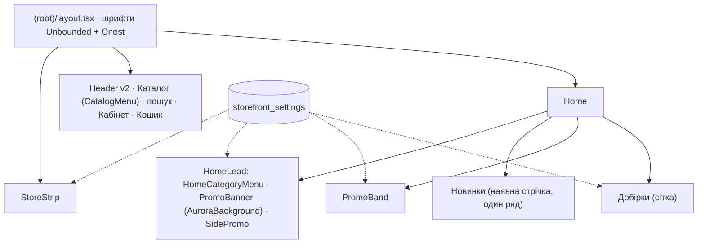

# TD-0015 — Нова головна й шапка сайту

- **Status:** Approved (власник 09.11.2026: «Давай» — разом із трьома рішеннями §9); реалізовано локально 09.11, незакомічено
- **Author:** Claude (за рішеннями власника 09.11.2026)
- **Reviewers:** власник
- **Date:** 2026-11-09
- **Components:** both (fillando-fe — головна, шапка, шрифти, «Вітрина»; fillando-be — поля налаштувань вітрини)
- **Related:** ескіз [«Fillando — головна, ескіз»](https://claude.ai/artifact/GZRuFenzHWWBrr3s6i1b26) (версія 3, фон «Аврора»); [TD-0013](TD-0013-general-catalog-and-seo.md) (каталог, SEO-матриця); [Plan-0010](../plans/plan-0010-general-catalog-and-seo.md) (B09/F05 — налаштування вітрини, P20 — хаб каталогу); `fillando-be/src/docs/STOREFRONT_SETTINGS.md`

> Номер TD-0014 колись мав відкочений документ про розділи каталогу, тому тут TD-0015.

## 1. Summary

Головна стає вітриною універсального магазину за структурою маркетплейсу (як Prom). Згори вниз: смужка з умовами, шапка з великим пошуком, перший ряд «меню категорій · банер · картка опту», стрічка новинок, смуга «Прайс-лист», добірки. Банер має абстрактний анімований фон «Аврора» у фірмових кольорах. Увесь текст блоків редагується у «Вітрині», про філамент у коді не лишається нічого. Шапка, смужка й нові шрифти (Unbounded + Onest) діють на всьому сайті. Власник вирішив робити це до релізу, разом із каталогом (09.11.2026).

## 2. Goals / Non-goals

**Goals**
- Структура головної — як в ескізі. Великий банер на весь екран, як і «пафос», відхилено власником.
- Жодного хардкоду товару чи категорії на вітрині:
  - банер «Все для 3D-друку… PLA, PETG…» і картинка з `/categories/slug/filament`;
  - «Чому Fillando» з текстом про філамент;
  - зашиті логотипи Kingroon, Sunlu й Bambu Lab на головній.
- Текст банера, смужки, картки опту й смуги посередині власник змінює у «Вітрині» тією ж однією шапкою «Зберегти», що вже є.
- Нова шапка й смужка на всіх сторінках вітрини. «Каталог» відкриває наявну панель дерева категорій (D06.5).
- Шрифти Unbounded (заголовки) й Onest (текст) на всій вітрині. Адмінка лишається на Inter.
- Фон «Аврора» не шкодить швидкості, SEO й доступності (§7).

**Non-goals**
- Конструктор секцій (додавати, переставляти, ховати блоки). Власник обрав фіксовану структуру з ескізу.
- Карусель банерів. Банер один.
- Бренди на головній. Їх прибрано разом із логотипами; бренд-сутності поза обсягом (рішення 29.10).
- Відгуки, «Обране», порівняння, чати. На сайті їх немає, і ця робота їх не додає.
- Логотипи брендів на `/price-sheet` (`MANUFACTURERS`). Це інша сторінка; хардкод там лишається відомим окремим питанням.

## 3. Background & context

Зараз `(root)/Home.tsx` складається з таких блоків:
- `Hero` — текст у коді, картинка з категорії `filament`;
- `HomeCategories` — плитки з `home_category_ids`;
- `BrandStrip` — константа `MANUFACTURERS`;
- `ValueProps` — текст у коді;
- `WholesaleBlock`;
- «Новинки» і добірки з «Вітрини».

Товари стоять у самому низу сторінки. Шапка (`common/components/Header.tsx`) містить логотип, «Каталог» (`CatalogMenu`), пункти меню, пошук, кошик і вхід. Шрифти: Inter і Geist Mono (`app/layout.tsx`). Налаштування вітрини (`storefront_settings`) зараз мають лише `home_category_ids` і `collections`. Їх пише `PATCH /storefront-settings` через ворота каталогу й журнал (профіль `settings`).

## 4. Requirements

**Функціональні**
- **Смужка:** до 4 коротких пунктів (наприклад, «Відправляємо Новою Поштою щодня») і телефон з `contacts.constants.ts`. Пункти — з «Вітрини», без пунктів смужки немає. На телефоні — один рядок: перший пункт і телефон.
- **Шапка:**
  - логотип, «Каталог» (панель дерева), великий пошук із кнопкою «Знайти», «Кабінет» (вхід або меню користувача), «Кошик» з лічильником;
  - пункти «Прайс-лист», «Опт», «FAQ», «Контакти» переходять у підвал і в меню головної;
  - на телефоні: рядок «Меню · логотип · Кабінет · Кошик», під ним пошук; «Каталог» на телефоні — меню з деревом (`MobileMenu`).
- **Меню головної ліворуч** (як в ескізі):
  - «Акції» — лише поки є акційні товари — і «Новинки»: якорі стрічок хаба `/catalog#akcii` і `/catalog#novynky` (стрічка не має власної адреси, а параметр лістингу на хабі дає 404);
  - категорії першого рівня публічного дерева в порядку дерева, з фото категорії з адмінки як іконкою (без фото — нейтральна плитка), не більше 10: меню стоїть в одному ряду з банером, і довший список розтягнув би обидва; решта — через «Усі товари» й «Каталог» у шапці;
  - «Усі товари» (`/catalog`) і «Прайс-лист»; стрілка в кожному рядку;
  - на телефоні меню сховане за «Меню» в шапці.
- **Банер:** надзаголовок, заголовок (це H1 сторінки) з виділеним фрагментом, текст, кнопка (підпис і внутрішня адреса). Фон — «Аврора».
- **Картка праворуч:** заголовок, текст, кнопка. Дія — або форма оптової заявки (наявний `WholesaleInquiryForm`), або внутрішня адреса.
- **«Новинки»:** один ряд карток (наявна `CatalogProductCard`), стрілки на комп'ютері, гортання на телефоні.
- **Смуга посередині:** заголовок, текст, кнопка з внутрішньою адресою. Типово — «Прайс-лист». Порожня смуга не показується.
- **Добірки:** наявні `collections`, відображення — сітка.
- **Порожні дані:** стрічка без товарів не показується (як зараз).

**Нефункціональні**
- **SEO:**
  - H1 і весь текст — серверний HTML;
  - LCP — текст банера, а не canvas;
  - головна лишається self-canonical; JSON-LD не змінюється.
- **Швидкість:**
  - «Аврора» — WebGL-шейдер без бібліотек (~3 КБ), рахується в половинній роздільності;
  - стартує після `requestIdleCallback`;
  - стоїть на паузі поза екраном і у фоновій вкладці;
  - на інших сторінках код не вантажиться;
  - зсуву макета немає: canvas під текстом, `position: absolute`.
- **Доступність:**
  - «менше руху» — один нерухомий кадр;
  - без WebGL — статичний градієнт тих самих кольорів;
  - контраст тексту банера забезпечує затемнення лівої частини.
- **Безпека:** адреси кнопок — лише внутрішні шляхи, що починаються з `/`. Текст — plain text, санітайзиться, HTML не приймається.

## 5. Proposed design

### 5.1 Компоненти

- **FE, нове:**
  - `StoreStrip` (`common/components`), `HomeCategoryMenu`, `PromoBanner`, `SidePromo`, `PromoBand`, `RailScroller` (`(root)/_home`); перший ряд — сітка в самому `Home.tsx`, окремого `HomeLead` немає;
  - `AuroraBackground` — клієнтський компонент із шейдером з ескізу;
  - `WholesaleFormButton` — кнопка з діалогом оптової заявки для картки праворуч.
- **FE, змінене:**
  - `Header` (нова розкладка, пункти меню переходять у підвал);
  - `(root)/layout.tsx` (шрифти, смужка);
  - `Home.tsx`;
  - `FeaturedProducts` (один ряд зі стрілками);
  - «Вітрина» (`admin/storefront`): блоки «Смужка», «Банер», «Картка праворуч», «Смуга посередині» в загальній шапці збереження.
- **FE, прибране:** `Hero`, `ValueProps`, `BrandStrip`, `HomeCategories`, `WholesaleBlock` на головній. Їхні тести прибираються або переписуються.
- **BE:** нові поля `storefront_settings`, валідація, публічна відповідь, документація.

### 5.2 Дані (`storefront_settings`)

| Поле | Форма | Обмеження |
|---|---|---|
| `strip` | `string[]` | ≤ 4 пунктів по ≤ 60 символів |
| `banner` | `{eyebrow, title, accent, text, button_label, button_href}` | `title` 1–80 (H1), `accent` — фрагмент `title`, який підсвічується (може бути порожнім); `text` ≤ 200; адреса — внутрішній шлях |
| `side_promo` | `{title, text, button_label, action: 'wholesale-form' \| 'link', button_href}` | `button_href` лише при `link` |
| `band` | `{title, text, button_label, button_href} \| null` | `null` — смуги немає |

- **Типові значення.** Якщо поля немає, BE повертає типові значення — текст з ескізу. Так зроблено й з типовим «Виробником» у новій категорії. Вони одразу редагуються. Окремої міграції даних не потрібно.
- **`home_category_ids`.** Прибрано з «Вітрини» й API (рішення §9): меню бере дерево. Перше збереження «Вітрини» видаляє поле з документа; доки воно там є, незмінене тіло не відповідає `SETTINGS_UNCHANGED`, щоб його можна було прибрати. Категорія більше не вважається «використаною» через нього — лише через добірки.
- **Запис.** Як зараз: `PATCH /storefront-settings` з `expected_revision` і `Idempotency-Key`. Журнал профілю `settings` дозволяє нові поля. Ревалідація того самого тегу `categories`.

### 5.3 API

- `PATCH /storefront-settings`: тіло доповнюється чотирма полями (§5.2). Невідоме поле — `400`, як зараз. Порушення обмежень — `400` з полем. Незмінене тіло — `409 SETTINGS_UNCHANGED`.
- `GET /storefront-settings` і `GET /storefront-settings/admin` повертають нові поля, з типовими значеннями, якщо поля не збережено.
- Після змін — `yarn spec:export`.

### 5.4 Шапка на всьому сайті

- **Розкладка.** Смужка й шапка однакові на всіх сторінках вітрини (`(root)/layout.tsx`). «Каталог» — наявний `CatalogMenu`: дворівневе дерево в HTML, глибше ліниво, поріг 150 посилань (рішення 30.10). Пошук — наявний компонент, ширший.
- **Пункти меню.** «Прайс-лист», «Опт», «FAQ» і «Контакти» переходять у підвал, а «Прайс-лист» і «Усі товари» — ще й у меню головної.
- **Телефон.** `MobileMenu` лишається для навігації.

### 5.5 Фон «Аврора»

- **Код.** Шейдер з ескізу: fbm-шум зі зсувом, кольори `#0b1220`, `#1bb894`, `#19e6b3`, `#1890db`, зерно й затемнення ліворуч. Канвас рахується в половинній роздільності.
- **Цикл.** `requestAnimationFrame` зупиняється через `IntersectionObserver` і `visibilitychange`. Ініціалізація — після `requestIdleCallback`; до неї видно CSS-градієнт тих самих кольорів.
- **Обмеження.** `prefers-reduced-motion` — один кадр. Без WebGL — лише градієнт.

### 5.6 Шрифти

- **Підключення.** `next/font/google`: Unbounded (500, 700; cyrillic, latin) — для заголовків; Onest (400, 500, 600, 700; cyrillic, latin) — для тексту; Geist Mono лишається. Токени шрифтів у `globals.css`.
- **Обсяг.** Лише макет вітрини `(root)`; макет адмінки лишається на Inter.
- **Перевірка.** Візуально пройти ключові сторінки: головна, каталог, лендінг, товар, кошик, оформлення замовлення, кабінет, прайс-лист.

## 6. Alternatives considered

- **Конструктор секцій** (варіант А від 09.11). Гнучкіший, але власник обрав фіксовану структуру з ескізу. Конструктор можна додати пізніше, не міняючи дані блоків.
- **Великий банер на весь екран з анімованим фоном.** Ескізи 1–2: власник визнав їх надто пафосними.
- **Тексти блоків у коді FE**, як вступ над `/catalog` (рішення 03.11). Суперечить правилу власника «ніякого хардкоду», тому тексти в налаштуваннях.
- **Карусель банерів.** Каруселі на банері майже не клікають, і кожен слайд — окремий вміст для підтримки.

## 7. SEO, швидкість, доступність

- **Що бачить Google.** H1 — заголовок банера з «Вітрини». Решта сторінки — серверний HTML: меню (посилання на категорії), стрічки (посилання на товари). Анімація не впливає на LCP.
- **Метрики.** CLS = 0: фон абсолютний, шрифти з `display: swap` і `size-adjust` від `next/font`.
- **Мобільні.** Половинна роздільність, пауза поза екраном і у фоновій вкладці. Замір часу кадру з початкового задуму не зроблено: WebGL малює асинхронно, і час виклику в JS не показує, скільки рахує GPU.

## 8. Testing

- **BE:** `storefront-settings.int-spec.ts` — нові поля, обмеження (довжини, лише внутрішні адреси, `accent` всередині `title`), типові значення, `SETTINGS_UNCHANGED`. Unit-тести схеми.
- **FE:**
  - тести блоків головної (порожні дані → блоку немає, H1 з налаштувань);
  - шапка: «Каталог», пошук, кабінет, кошик, мобільна розкладка;
  - «Вітрина»: нові блоки в загальній шапці збереження;
  - `AuroraBackground`: «менше руху» → один кадр, без WebGL → градієнт.
- **E2E:** оновити `release/*` і mock-сценарії, що проходять через шапку й головну.
- **Ручна перевірка:** Lighthouse головної (LCP, CLS) до й після; візуальний прохід сторінок з §5.6.

## 9. Рішення (власник 09.11.2026, «Давай»)

1. **`home_category_ids`** прибрано з «Вітрини» й API; меню головної бере дерево категорій.
2. **Стрічки «Акції»** на головній немає, як в ескізі. Вона лишається на хабі `/catalog`.
3. **Телефон у смужці** — з `contacts.constants.ts`, як скрізь на сайті.

## 9a. Що вийшло інакше, ніж у задумі

- **Фон банера й картки праворуч** задано двома класами: колір окремо, градієнт окремо (`bg-[#0b1220] bg-[image:…]`). Одним класом `bg-[radial-gradient(…),#0b1220]` Tailwind пише недійсний `background-image`, і браузер відкидає все: до старту «Аврори» чи без WebGL білий H1 стояв на світлому тлі сторінки. Знайдено на знімку стенду без WebGL.
- **Заголовки сторінок** (H1 каталогу, категорії, товару) лишились на Onest; Unbounded — на головній і в логотипі. Широкий шрифт на довгих назвах товарів читається важко. Поширити Unbounded на всі заголовки — окреме рішення власника.
- **Меню головної** спершу вийшло без «Акцій», «Новинок» і іконок, з додатковим «Оптовим клієнтам». Власник звірив з ескізом (09.11) — приведено до ескізу. Кольори іконок категорій в ескізі були вигадані; замість них — фото категорії з адмінки, тобто дані, а не код.
- **Розміри — за CSS ескізу** (звірено 09.11 рендером обох у вікні 1440 px при 100%): H1 34 px, колонки 240/280, пошук 48 px, «Кабінет»/«Кошик» — іконка 22 px над підписом 12 px, перший ряд на комп'ютері не нижчий за 400 px (в ескізі його висоту давали два рядки-«приклади» в меню). Знімок ескізу, який здавався більшим, був зроблений при масштабі браузера 110%.
- **Сітка добірки — лише повні ряди** (власник 10.11): стрічка має 8 карток, тому на комп'ютері (6 колонок) виходило 6 + 2. Тепер видно 6, як в ескізі; на планшеті (4 колонки) й телефоні (2) — усі 8. Зайві картки ховаються CSS на своїй ширині й лишаються в HTML.
- **«Кабінет» після входу** — так само іконка (аватар) над підписом «Кабінет», як в ескізі; ім'я — всередині меню (`aria-label` «Кабінет: <ім'я>»). Раніше там була широка плашка з іменем.
- **Кнопка «Кошик»** має `aria-label='Кошик'`, як стара: лічильник не входить у її назву, і release E2E знаходить її так само.
- **Картка стрічки — товар, а не колір** (власник 14.11, [ескіз каталогу](https://claude.ai/artifact/PF9nxkvr4akXJ83RuEnwjp); Plan-0010 P26). «Новинки» брали 8 останніх SKU, а товар приходить одразу з усіма кольорами: стрічку займав один товар у семи кольорах, і колір у кінці назви обрізався. Тепер стрічки головної й хаба читають `GET /products/catalog/v2/strip` — одна картка на товар (`StripProductCard`): назва товару, кружечки кольорів, «від N ₴», «Обрати колір»; товар з одним варіантом лишає «В кошик». Стрічка з одного-двох товарів — широкі картки на всю ширину. Вимога «наявна `CatalogProductCard`» з §5 стосується тепер лише сітки категорії й пошуку.
- **Нижня частина головної переглянута** (власник 14.11: перший ряд «гарно», решта «щось не те»; [макет](https://claude.ai/artifact/C12tBPY9eZkjGnEnn6WZqh), комп'ютер і телефон; Plan-0010 P28). Ескіз 09.11 мав під першим рядом стрічку, світлу смугу й добірки сіткою — так і було зроблено. На стенді добірка за головною категорією повторювала «Новинки» (5 товарів із 6), а блоки були однієї форми й блідіші за перший ряд. Тепер: товар на сторінці не повторюється (крім добірок з обраних вручну товарів); добірка — полиця з темною обкладинкою (фото, назва, кількість, «Дивитися всі») і п'ятьма картками, на телефоні — компактна обкладинка й чотири картки; смуга темна; стрілка стрічки ховається, коли гортати нікуди. Пункти §5 «Смуга посередині» й «Добірки: відображення — сітка» читати з цією поправкою. Того ж дня власник попросив для смуги й обкладинок «гарний живий фон»: вони отримали ту саму «Аврору», що й банер, але одним спільним WebGL-контекстом на всі картки (поле малюється раз на кадр, кожна картка показує свій фрагмент) — окремий шейдер на кожну картку дав би до тринадцяти контекстів на сторінці. Правила ті самі, що в §5 для банера: пауза поза екраном і у фоновій вкладці, один кадр за «менше руху», градієнт без WebGL.
- **Unbounded на хабі `/catalog`** (власник 14.11): H1 і заголовки блоків хаба набрано тим самим шрифтом, що й стрічки. H1 категорії й товару лишаються на Onest.

## 10. Обсяг

Приблизно 4–5 робочих днів:

| Частина | Оцінка |
|---|---|
| BE: поля, валідація, тести, документація | ~0,5 дня |
| Шрифти й візуальний прохід | ~0,5 дня |
| Шапка й смужка на всьому сайті, мобільна розкладка | ~1 день |
| Головна й «Аврора» | ~1–1,5 дня |
| «Вітрина» | ~0,5 дня |
| Тести, E2E, документація (FRD, Plan-0010 + PDF, трекер Plan-0005) | ~1 день |

Рядок у Plan-0010 — P25 (§8).
